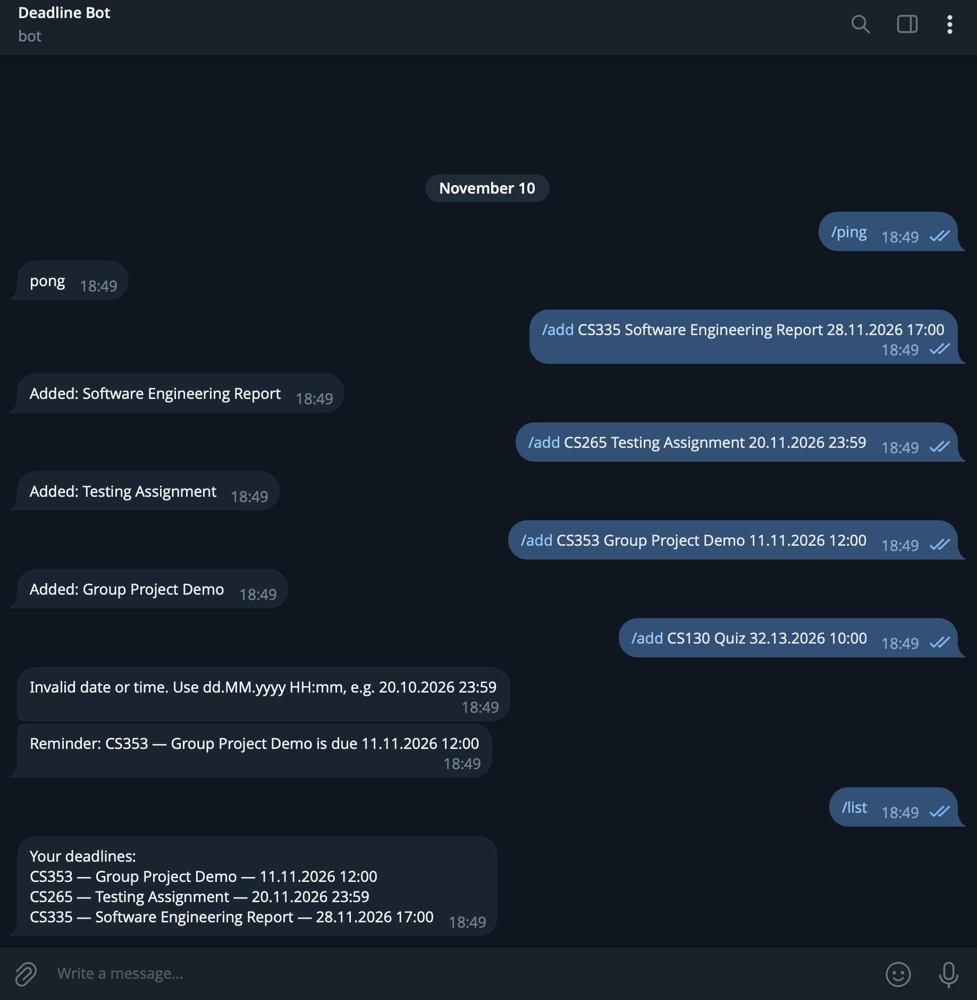

# Deadline Bot

A Telegram bot that helps students keep track of their university deadlines.



## Features

- `/add` — add a new deadline
- `/list` — see all your deadlines, sorted by date
- `/ping` — check that the bot is running
- Automatic reminders 24 hours and 1 hour before each deadline

## Example

```
/add CS301 Essay 25.10.2026 23:59
→ Added: Essay

/list
→ Your deadlines:
  CS301 — Essay — 25.10.2026 23:59

(24 hours before the deadline)
→ Reminder: CS301 — Essay is due 25.10.2026 23:59

/add CS301 Essay 32.13.2026 23:59
→ Invalid date or time. Use dd.MM.yyyy HH:mm, e.g. 20.10.2026 23:59
```

## Tech stack

- Java 21
- Maven
- TelegramBots 10.3.0
- SQLite (via JDBC)

## Project structure

- `Main` — reads the bot token from an environment variable and starts the bot.
- `DeadlineBot` — receives messages from Telegram, handles commands, and checks for upcoming deadlines every minute using a `ScheduledExecutorService`.
- `DeadlineParser` — checks the format of the `/add` command and turns the text into a `Deadline`.
- `Deadline` — a model of one deadline: course, title and due date.
- `DeadlineStore` — saves deadlines to a SQLite database using JDBC and prepared statements, returns them sorted by date for each chat, and finds deadlines that need a reminder.
- `Reminder` — a record with a deadline and the chat it belongs to, used for sending reminders.

Each class has one responsibility, so the parsing and storage logic can be changed or tested without touching the Telegram code.

## How to run

1. Create a bot with [@BotFather](https://t.me/BotFather) in Telegram (`/newbot`) and copy the token it gives you.
2. Clone this repository and open it in IntelliJ IDEA (Java 21 is required).
3. Set the token as an environment variable `BOT_TOKEN`
   (Run → Edit Configurations → Environment variables: `BOT_TOKEN=your_token`).
   The token is never stored in the code.
4. Run `Main` and send `/ping` to your bot. It should reply `pong`.

The database file `deadlines.db` is created automatically on the first run. Reminders are sent only while the bot is running.

## Roadmap

- [x] Store deadlines in a database so they are not lost after a restart
- [x] Send a reminder one day before a deadline
- [x] Send a second reminder one hour before a deadline
- [ ] Add `/start`, `/help` and `/delete` commands
- [ ] Replace `printStackTrace` with proper logging
- [ ] Deploy the bot to a server so it runs 24/7